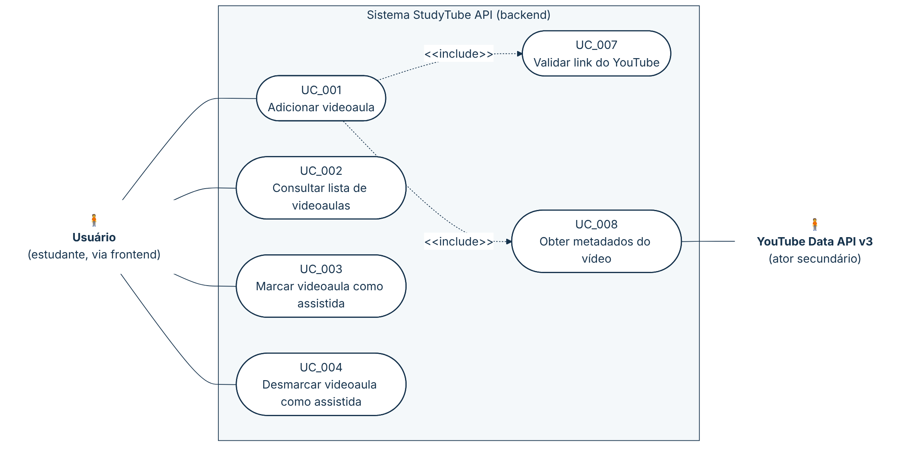

# 🔄 4.2 Diagrama e especificação de casos de uso

> **PADRÃO DA DISCIPLINA** Nome do caso de uso começa com verbo no infinitivo; IDs `UC_001`; todo passo começa por quem executa ("Usuário …", "Sistema …"); descreve **o que** acontece, não **como** (sem "clica", "duplo clique"); o fluxo principal não tem passos condicionais; fluxo alternativo (FA) = escolha do usuário que substitui um passo; fluxo de exceção (FE) = validação de regra de negócio que o usuário não escolheu; todo FA/FE termina com "Retorna ao passo N do fluxo principal" ou "Fim do caso de uso".

## 4.2.1 Diagrama de casos de uso — visão do backend

*Figura 1 — Diagrama de casos de uso da StudyTube API. Escopo: backend. v1.0 · 21/10/2026 · Daniele Benfica. Referências: RF01–RF05. Fonte editável: [`img/diagrama-casos-de-uso.mmd`](img/diagrama-casos-de-uso.mmd).*

**Leitura do diagrama.** O Usuário acessa a API pelo frontend. Adicionar uma videoaula **sempre** valida o link (UC_007) e **sempre** busca os metadados no YouTube (UC_008); por isso as relações são `<<include>>` (ação obrigatória). Os casos de uso UC_005 (Assistir videoaula na página) e UC_006 (Acompanhar progresso de estudos) existem apenas na interface web e estão na documentação do frontend, com os mesmos códigos.

| ID | Caso de uso | Ator principal | Requisitos | Estado |
|---|---|---|---|---|
| UC_001 | Adicionar videoaula | Usuário | RF01, RF05 | ✅ |
| UC_002 | Consultar lista de videoaulas | Usuário | RF02 | ✅ |
| UC_003 | Marcar videoaula como assistida | Usuário | RF03 | ✅ |
| UC_004 | Desmarcar videoaula como assistida | Usuário | RF04 | ✅ |
| UC_005 | Assistir videoaula na página | Usuário | (frontend) | ✅ no frontend |
| UC_006 | Acompanhar progresso de estudos | Usuário | (frontend) | ✅ no frontend |
| UC_007 | Validar link do YouTube (incluído) | — | RF05 | ✅ |
| UC_008 | Obter metadados do vídeo (incluído) | YouTube Data API v3 | RF01, RF05 | ✅ |

## 4.2.2 UC_001 – Adicionar videoaula

**Formato casual.** O usuário informa a URL de um vídeo do YouTube. O sistema extrai e valida o identificador, confere se o vídeo ainda não está na lista, busca título, canal, miniatura e duração no YouTube, grava a videoaula como não assistida e devolve os dados cadastrados.

| NOME DO CASO DE USO | UC_001 – Adicionar videoaula |
|---|---|
| ATORES | Usuário (estudante, via frontend); YouTube Data API v3 (secundário, via UC_008) |
| PRÉ-CONDIÇÕES | A API está em execução. A chave `YouTube:ApiKey` está configurada. |
| PÓS-CONDIÇÕES | A videoaula está gravada na lista como não assistida e seus dados foram devolvidos ao usuário. |
| FLUXO PRINCIPAL | 1) Usuário indica que deseja adicionar uma videoaula à lista. 2) Usuário informa a URL do vídeo no formato `https://www.youtube.com/watch?v={id}`. 3) Sistema extrai o identificador do vídeo e valida o seu formato, conforme UC_007 (RN01, RN02). 4) Sistema verifica que o vídeo ainda não está na lista (RN05). 5) Sistema obtém título, canal, miniatura e duração do vídeo, conforme UC_008. 6) Sistema cria a videoaula como não assistida (RN03, RN04, RN08). 7) Sistema registra a videoaula na lista. 8) Sistema apresenta os dados da videoaula cadastrada e o endereço do novo recurso (HTTP 201 Created). Fim do caso de uso. |
| FLUXOS ALTERNATIVOS | **FA_01 – Informar link em outro formato aceito** 2.a.1) Usuário informa a URL em outro formato aceito: `https://youtu.be/{id}`, `https://www.youtube.com/embed/{id}`, `https://www.youtube.com/shorts/{id}` ou com os hosts `youtube.com` / `m.youtube.com`. Retorna ao passo 3 do fluxo principal. |
| FLUXOS DE EXCEÇÃO | **FE_01 – URL não informada** 2.b.1) Sistema verifica que o campo `url` não foi informado ou está vazio. 2.b.2) Sistema rejeita a solicitação com HTTP 400 e a validação "The Url field is required." (Problem Details). Fim do caso de uso.  **FE_02 – URL inválida (RN02)** 3.a.1) Sistema verifica que a URL não é um endereço absoluto. 3.a.2) Sistema apresenta a mensagem "URL inválida." (HTTP 400). Fim do caso de uso.  **FE_03 – Endereço não é de vídeo do YouTube (RN02)** 3.b.1) Sistema verifica que o host ou o caminho não corresponde a um vídeo do YouTube. 3.b.2) Sistema apresenta a mensagem "Não é uma URL de vídeo do YouTube." (HTTP 400). Fim do caso de uso.  **FE_04 – Identificador do vídeo inválido (RN01)** 3.c.1) Sistema verifica que o identificador não tem 11 caracteres válidos. 3.c.2) Sistema apresenta a mensagem "ID do YouTube inválido." (HTTP 400). Fim do caso de uso.  **FE_05 – Vídeo já está na lista (RN05)** 4.a.1) Sistema verifica que já existe videoaula com o mesmo identificador. 4.a.2) Sistema apresenta a mensagem "Este vídeo já está na sua lista." (HTTP 400). Fim do caso de uso.  **FE_06 – Vídeo não encontrado no YouTube (RN09)** 5.a.1) Sistema verifica que o YouTube não devolveu o vídeo. 5.a.2) Sistema apresenta a mensagem "Vídeo não encontrado no YouTube." (HTTP 400). Fim do caso de uso.  **FE_07 – Falha na comunicação com a YouTube Data API** 5.b.1) Sistema não obtém resposta válida do YouTube (chave ausente ou recusada, cota excedida ou falha de rede). 5.b.2) Sistema encerra a solicitação com HTTP 500, sem mensagem de negócio e sem gravar a videoaula. Fim do caso de uso.  **FE_08 – Dados do vídeo inválidos (RN03, RN04)** 6.a.1) Sistema verifica que o título está vazio ou que a duração é negativa. 6.a.2) Sistema apresenta a mensagem "O título é obrigatório." ou "A duração não pode ser negativa." (HTTP 400). Fim do caso de uso. |

## 4.2.3 UC_002 – Consultar lista de videoaulas

**Formato casual.** O usuário pede a lista e o sistema devolve todas as videoaulas cadastradas, da mais recente para a mais antiga.

| NOME DO CASO DE USO | UC_002 – Consultar lista de videoaulas |
|---|---|
| ATORES | Usuário (estudante, via frontend) |
| PRÉ-CONDIÇÕES | A API está em execução. |
| PÓS-CONDIÇÕES | O usuário recebe a lista de videoaulas (vazia, quando não há cadastro). Nada é alterado. |
| FLUXO PRINCIPAL | 1) Usuário solicita a lista de videoaulas. 2) Sistema recupera as videoaulas cadastradas, da mais recente para a mais antiga pela data de inclusão. 3) Sistema apresenta, para cada videoaula, identificador, ID do YouTube, título, canal, miniatura, duração, estado de assistida e datas (HTTP 200). Fim do caso de uso. |
| FLUXOS ALTERNATIVOS | Não há. |
| FLUXOS DE EXCEÇÃO | Não há regra de negócio validada neste caso de uso. Uma lista sem cadastros é devolvida como `[]`, sem erro. |

## 4.2.4 UC_003 – Marcar videoaula como assistida

**Formato casual.** O usuário indica que concluiu uma videoaula; o sistema registra o estado de assistida com a data e a hora.

| NOME DO CASO DE USO | UC_003 – Marcar videoaula como assistida |
|---|---|
| ATORES | Usuário (estudante, via frontend) |
| PRÉ-CONDIÇÕES | A videoaula está cadastrada na lista. |
| PÓS-CONDIÇÕES | A videoaula está assistida (`Watched = true`) com a data e a hora da marcação (`WatchedAt`, UTC). |
| FLUXO PRINCIPAL | 1) Usuário indica a videoaula que concluiu. 2) Sistema localiza a videoaula pelo identificador. 3) Sistema verifica que a videoaula ainda não está assistida (RN06). 4) Sistema registra a videoaula como assistida, com a data e a hora. 5) Sistema apresenta a videoaula atualizada (HTTP 200). Fim do caso de uso. |
| FLUXOS ALTERNATIVOS | Não há. |
| FLUXOS DE EXCEÇÃO | **FE_01 – Videoaula não encontrada** 2.a.1) Sistema verifica que não existe videoaula com o identificador informado (ou que o identificador não é um GUID). 2.a.2) Sistema responde HTTP 404 Not Found. Fim do caso de uso.  **FE_02 – Videoaula já assistida (RN06)** 3.a.1) Sistema verifica que a videoaula já está assistida. 3.a.2) Sistema apresenta a mensagem "Este vídeo já foi marcado como assistido." (HTTP 400). Fim do caso de uso. |

## 4.2.5 UC_004 – Desmarcar videoaula como assistida

**Formato casual.** O usuário desfaz a marcação de uma videoaula; o sistema volta o estado para não assistida e apaga a data da marcação.

| NOME DO CASO DE USO | UC_004 – Desmarcar videoaula como assistida |
|---|---|
| ATORES | Usuário (estudante, via frontend) |
| PRÉ-CONDIÇÕES | A videoaula está cadastrada na lista. |
| PÓS-CONDIÇÕES | A videoaula está não assistida (`Watched = false`, `WatchedAt = null`). |
| FLUXO PRINCIPAL | 1) Usuário indica a videoaula que deseja desmarcar. 2) Sistema localiza a videoaula pelo identificador. 3) Sistema registra a videoaula como não assistida e remove a data da marcação (RN07). 4) Sistema apresenta a videoaula atualizada (HTTP 200). Fim do caso de uso. |
| FLUXOS ALTERNATIVOS | Não há. |
| FLUXOS DE EXCEÇÃO | **FE_01 – Videoaula não encontrada** 2.a.1) Sistema verifica que não existe videoaula com o identificador informado (ou que o identificador não é um GUID). 2.a.2) Sistema responde HTTP 404 Not Found. Fim do caso de uso. |

> **VARIANTES** UC_003 e UC_004 poderiam ser escritos como um único caso de uso "Manter estado de estudo da videoaula" com duas variantes (marcar / desmarcar), como o material da disciplina mostra para operações de cadastro. Foram mantidos separados porque têm endpoints, regras e testes diferentes.

## 4.2.6 UC_007 – Validar link do YouTube (incluído por UC_001)

| NOME DO CASO DE USO | UC_007 – Validar link do YouTube |
|---|---|
| ATORES | — (executado pelo Sistema dentro do UC_001) |
| PRÉ-CONDIÇÕES | O Usuário informou uma URL no UC_001. |
| PÓS-CONDIÇÕES | O identificador do vídeo (11 caracteres) está disponível para o UC_001. |
| FLUXO PRINCIPAL | 1) Sistema verifica que a URL é um endereço absoluto. 2) Sistema identifica um host e um caminho de vídeo do YouTube aceitos (RN02). 3) Sistema extrai o identificador do vídeo do caminho ou do parâmetro `v`. 4) Sistema valida o formato do identificador (RN01). Retorna ao passo 4 do UC_001. |
| FLUXOS ALTERNATIVOS | Não há. |
| FLUXOS DE EXCEÇÃO | **FE_01 – URL inválida:** 1.a.1) Sistema apresenta "URL inválida.". Fim do caso de uso (UC_001 FE_02). **FE_02 – Não é URL de vídeo:** 2.a.1) Sistema apresenta "Não é uma URL de vídeo do YouTube.". Fim do caso de uso (UC_001 FE_03). **FE_03 – ID inválido:** 4.a.1) Sistema apresenta "ID do YouTube inválido.". Fim do caso de uso (UC_001 FE_04). |

## 4.2.7 UC_008 – Obter metadados do vídeo (incluído por UC_001)

| NOME DO CASO DE USO | UC_008 – Obter metadados do vídeo |
|---|---|
| ATORES | YouTube Data API v3 (secundário) |
| PRÉ-CONDIÇÕES | Identificador válido e ainda não cadastrado. Chave de API configurada. |
| PÓS-CONDIÇÕES | Título, canal, miniatura e duração do vídeo estão disponíveis para o UC_001. |
| FLUXO PRINCIPAL | 1) Sistema solicita à YouTube Data API v3 os dados do vídeo (`snippet` e `contentDetails`). 2) YouTube Data API v3 devolve título, canal, miniaturas e duração. 3) Sistema seleciona a miniatura de qualidade `high` (ou `default`, quando não houver `high`). 4) Sistema converte a duração do formato ISO 8601 (ex.: `PT4M13S`) para `TimeSpan`. Retorna ao passo 6 do UC_001. |
| FLUXOS ALTERNATIVOS | Não há. |
| FLUXOS DE EXCEÇÃO | **FE_01 – Vídeo não devolvido (RN09):** 2.a.1) YouTube Data API v3 devolve a lista de itens vazia. 2.a.2) Sistema apresenta "Vídeo não encontrado no YouTube.". Fim do caso de uso (UC_001 FE_06). **FE_02 – Falha de comunicação:** 2.b.1) YouTube Data API v3 responde com erro HTTP ou não responde. 2.b.2) Sistema encerra com HTTP 500. Fim do caso de uso (UC_001 FE_07). |

---

## 📚 Referências

<!-- REFS-INICIO -->
- COCKBURN, Alistair. **Escrevendo casos de uso eficazes**: um guia prático para desenvolvedores de software. Tradução: Roberto Vedoato. Porto Alegre: Bookman, 2005. (Ciência da computação). ISBN 9788536304571.
- PRESSMAN, Roger S.; MAXIM, Bruce. **Engenharia de software**: uma abordagem profissional. Tradução: Francisco Araújo da Costa. 9. ed. Porto Alegre: McGraw-Hill, 2021. E-book. ISBN 9786558040118.
- REINEHR, Sheila. **Engenharia de requisitos**. Porto Alegre: SAGAH, 2020. E-book. (Engenharia de software). ISBN 9786556900674.
- EASY AGILE. **Use cases vs. user stories**: how they differ and when to use them. 8 jun. 2021. Disponível em: https://www.easyagile.com/blog/use-cases-vs-user-stories/. Acesso em: 21 out. 2026.
- PUCKETT, Dan. **Será que os casos de uso têm lugar no Scrum?** Tradução: Marcelo Costa. InfoQ Brasil, 19 nov. 2010. Disponível em: https://www.infoq.com/br/news/2010/11/use-cases-in-scrum/. Acesso em: 21 out. 2026.
- Lista completa (normas ISO/IEC/IEEE, UML, C4, OpenAPI e material da disciplina): [referencias.md](referencias.md).
<!-- REFS-FIM -->
