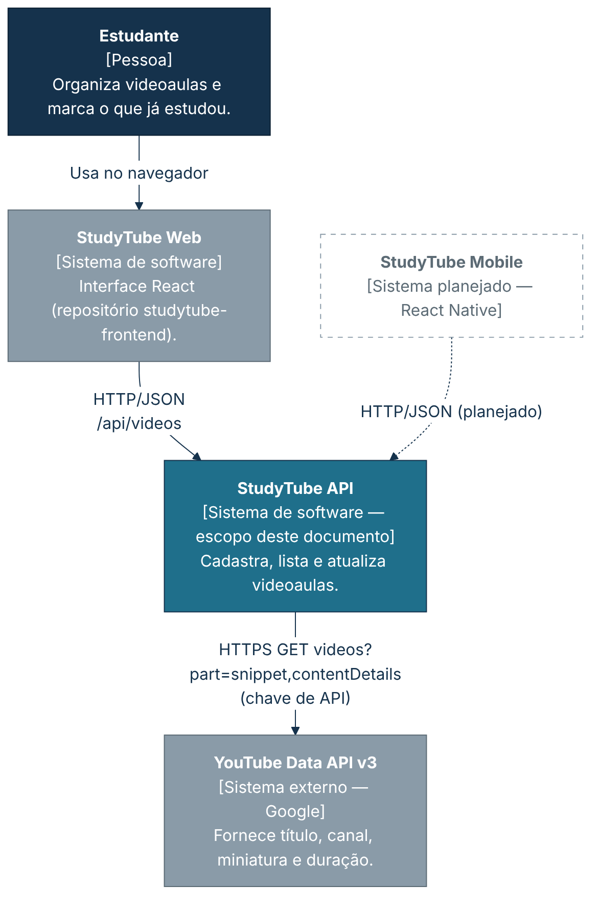
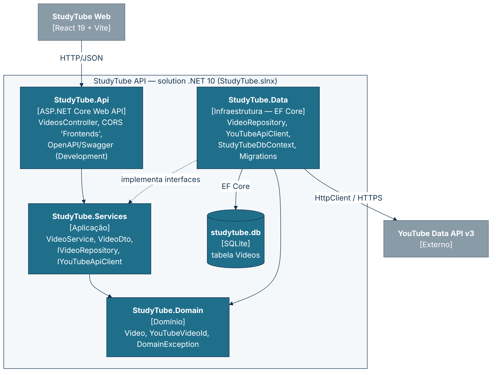
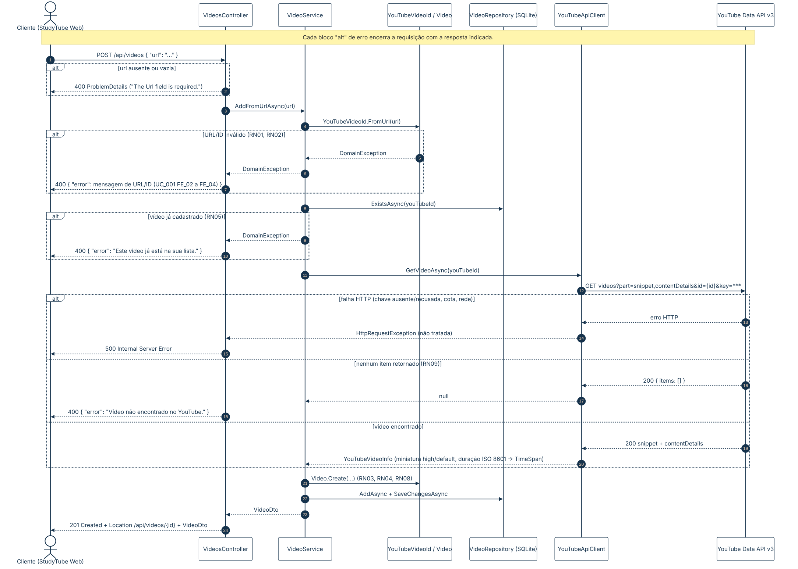
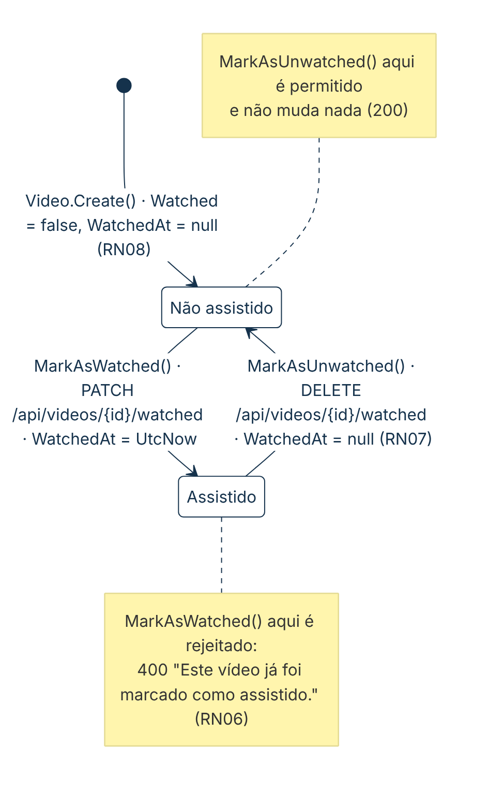
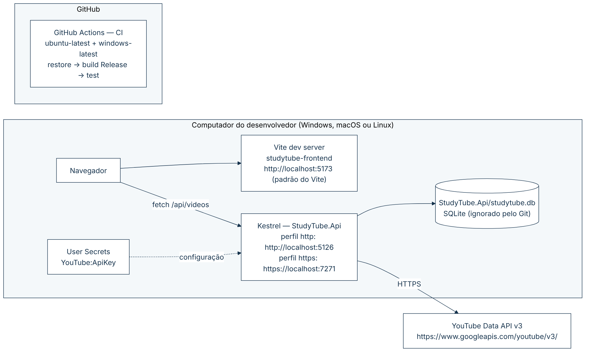
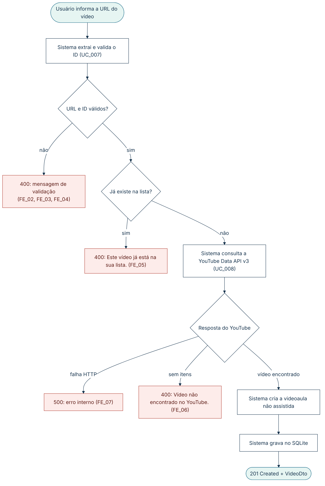

# 🧩 5. Diagramas e fluxos ponta a ponta

| Representação | Pergunta que responde | Aplicação no backend |
|---|---|---|
| Diagrama de casos de uso (UML) | Quem usa o sistema e para quê? | ✅ [4.2](04.2-casos-de-uso.md) |
| Jornada de usuário | O que a pessoa faz no App/Web? | Não aplicável ao backend — está na documentação do frontend. |
| Fluxo funcional (estilo BPMN simplificado) | Quais tarefas, decisões e exceções existem? | ✅ 5.6 (Adicionar videoaula) |
| C4 Context | Quais usuários e sistemas externos interagem? | ✅ 5.1 |
| C4 Container | Quais aplicações e componentes compõem a solução? | ✅ 5.2 |
| UML Sequence | Qual a ordem das chamadas e respostas? | ✅ 5.3 (`POST /api/videos`) |
| UML State Machine | Quais estados e transições são válidos? | ✅ 5.4 (`Video`) |
| Deployment | Onde executa e como operar? | ✅ 5.5 (ambiente local + CI) |

**Regras gráficas.** Toda figura tem título, escopo, versão/data, responsável e referência ao requisito ou fluxo. O arquivo-fonte Mermaid (`.mmd`) fica ao lado do PNG em `docs/img`; para atualizar, edite o `.mmd` e gere o PNG de novo com `npx @mermaid-js/mermaid-cli -i arquivo.mmd -o arquivo.png`.

## 5.1 C4 Context

*Figura 2 — C4 Context da StudyTube API. Escopo: sistema. v1.0 · 21/10/2026 · Daniele Benfica. Ref.: RF01–RF05, RF08 (mobile planejado). Fonte: [`img/c4-contexto.mmd`](img/c4-contexto.mmd).*

## 5.2 C4 Container

*Figura 3 — C4 Container (projetos da solution). Escopo: backend. v1.0 · 21/10/2026 · Daniele Benfica. Ref.: RNF02, [3.2](03-arquitetura-da-informacao.md). Fonte: [`img/c4-container.mmd`](img/c4-container.mmd).*

## 5.3 UML Sequence — `POST /api/videos`

*Figura 4 — Sequência do cadastro de videoaula, com chamada à YouTube Data API v3 e erros. v1.0 · 21/10/2026 · Daniele Benfica. Ref.: UC_001, UC_007, UC_008, FLOW-VID-001. Fonte: [`img/sequencia-post.mmd`](img/sequencia-post.mmd).*

## 5.4 UML State Machine — entidade `Video`

*Figura 5 — Estados da videoaula: não assistida ⇄ assistida. v1.0 · 21/10/2026 · Daniele Benfica. Ref.: RN06, RN07, RN08, UC_003, UC_004. Fonte: [`img/estados-video.mmd`](img/estados-video.mmd).*

| Estado atual | Evento | Novo estado | Resultado |
|---|---|---|---|
| (início) | `Video.Create` | Não assistida | `Watched = false`, `WatchedAt = null` |
| Não assistida | `MarkAsWatched` (PATCH) | Assistida | `200`, `WatchedAt = UtcNow` |
| Assistida | `MarkAsWatched` (PATCH) | Assistida | `400` "Este vídeo já foi marcado como assistido." |
| Assistida | `MarkAsUnwatched` (DELETE) | Não assistida | `200`, `WatchedAt = null` |
| Não assistida | `MarkAsUnwatched` (DELETE) | Não assistida | `200`, sem efeito |

## 5.5 Deployment

*Figura 6 — Implantação: ambiente local de desenvolvimento e CI no GitHub Actions. v1.0 · 21/10/2026 · Daniele Benfica. Ref.: RNF01, RNF04, [4.6](04.6-procedimento-operacional.md). Fonte: [`img/implantacao.mmd`](img/implantacao.mmd).*

## 5.6 Fluxo funcional — Adicionar videoaula

*Figura 7 — Fluxo funcional de FLOW-VID-001 com decisões e exceções. v1.0 · 21/10/2026 · Daniele Benfica. Ref.: UC_001. Fonte: [`img/fluxo-adicionar.mmd`](img/fluxo-adicionar.mmd).*

## 5.7 Regra de granularidade

Cada fluxo ponta a ponta tem **uma** página central no [Anexo B](anexo-b-fluxos-ponta-a-ponta.md) com objetivo, atores, pré-condições, passos, dados, exceções, resultado e testes. Os detalhes de tela ficam no frontend e os detalhes de código ficam nesta pasta, apenas referenciados.

---

## 📚 Referências

<!-- REFS-INICIO -->
- COCKBURN, Alistair. **Escrevendo casos de uso eficazes**: um guia prático para desenvolvedores de software. Tradução: Roberto Vedoato. Porto Alegre: Bookman, 2005. (Ciência da computação). ISBN 9788536304571.
- PRESSMAN, Roger S.; MAXIM, Bruce. **Engenharia de software**: uma abordagem profissional. Tradução: Francisco Araújo da Costa. 9. ed. Porto Alegre: McGraw-Hill, 2021. E-book. ISBN 9786558040118.
- REINEHR, Sheila. **Engenharia de requisitos**. Porto Alegre: SAGAH, 2020. E-book. (Engenharia de software). ISBN 9786556900674.
- EASY AGILE. **Use cases vs. user stories**: how they differ and when to use them. 8 jun. 2021. Disponível em: https://www.easyagile.com/blog/use-cases-vs-user-stories/. Acesso em: 21 out. 2026.
- PUCKETT, Dan. **Será que os casos de uso têm lugar no Scrum?** Tradução: Marcelo Costa. InfoQ Brasil, 19 nov. 2010. Disponível em: https://www.infoq.com/br/news/2010/11/use-cases-in-scrum/. Acesso em: 21 out. 2026.
- Lista completa (normas ISO/IEC/IEEE, UML, C4, OpenAPI e material da disciplina): [referencias.md](referencias.md).
<!-- REFS-FIM -->
