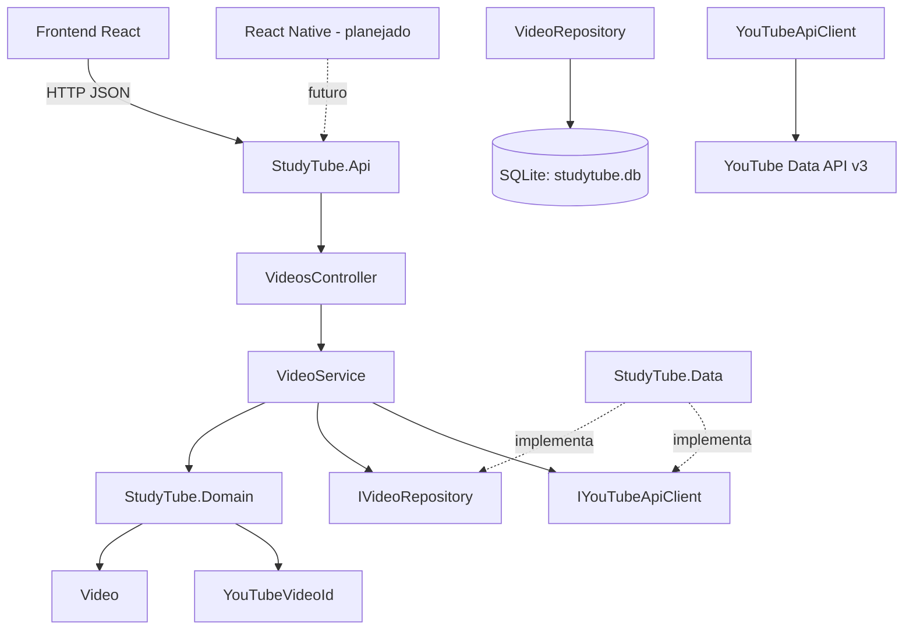

# StudyTube: Arquitetura e DDD

**Tipo:** Documentação técnica  
**Base:** Código atual do backend (`StudyTube.slnx`) e contrato consumido pelo frontend React.

Este documento descreve a arquitetura existente do StudyTube, os conceitos de Domain-Driven Design (DDD) aplicados ao projeto, as responsabilidades de cada camada e as decisões técnicas adotadas. As funcionalidades futuras são identificadas separadamente das implementadas.

---

## 1. Conceitos de DDD aplicados

### 1.1. Entidade rica: `Video`

O arquivo `StudyTube.Domain/Entities/Video.cs` implementa uma entidade de domínio rica, também chamada de *rich domain model*.

Suas características são:

- Propriedades com `private set`, protegendo o estado interno.
- Criação controlada por `Video.Create(...)`.
- Regras de criação aplicadas no domínio, incluindo título obrigatório, duração não negativa e identificador do YouTube válido.
- Comportamentos `MarkAsWatched()` e `MarkAsUnwatched()`, que encapsulam a mudança do estado de visualização e a atualização de `WatchedAt`.

Em um modelo anêmico, a entidade teria principalmente propriedades e deixaria as regras de negócio para outras camadas. No StudyTube, o serviço coordena o caso de uso, enquanto a entidade protege suas próprias invariantes.

### 1.2. Value object: `YouTubeVideoId`

O arquivo `StudyTube.Domain/ValueObjects/YouTubeVideoId.cs` implementa `YouTubeVideoId` como um *record* imutável.

Responsabilidades:

- Validar o formato do identificador, que deve conter 11 caracteres válidos.
- Extrair o identificador de URLs reconhecidas do YouTube por meio de `FromUrl(...)`.
- Lançar `DomainException` quando a URL ou o identificador forem inválidos.

Na persistência, o identificador é armazenado como texto. A conversão entre o value object e o tipo persistido é responsabilidade da configuração do Entity Framework Core em `VideoConfiguration`, na infraestrutura, e não do domínio.

### 1.3. Exceção de domínio: `DomainException`

`DomainException` representa uma violação de regra de domínio.

O `VideosController` traduz essa exceção em uma resposta HTTP 400, com um corpo JSON no formato:

```json
{
  "error": "Mensagem da exceção"
}
```

Assim, as regras são definidas no domínio, enquanto a camada de apresentação decide como comunicá-las ao cliente HTTP.

---

## 2. Camadas e direção das dependências

A solução utiliza uma arquitetura em camadas com princípios de DDD e inversão de dependência.

```text
StudyTube.Api ──────► StudyTube.Services ──────► StudyTube.Domain
     │                        ▲
     └──────► StudyTube.Data ─┘
```

| Camada | Projeto | Responsabilidades |
|---|---|---|
| Apresentação | `StudyTube.Api` | Controllers, injeção de dependência, CORS, OpenAPI/Swagger e aplicação das migrations na inicialização. |
| Aplicação | `StudyTube.Services` | Casos de uso, `VideoService`, DTOs como `VideoDto` e interfaces como `IVideoRepository` e `IYouTubeApiClient`. |
| Domínio | `StudyTube.Domain` | Entidades, value objects e exceções de domínio, sem dependência de bibliotecas de web ou persistência. |
| Infraestrutura | `StudyTube.Data` | Entity Framework Core, SQLite, repositório concreto, migrations e integração HTTP concreta com o YouTube. |

### 2.1. Regras de dependência

- `StudyTube.Domain` não referencia os outros projetos.
- `StudyTube.Services` referencia o domínio.
- `StudyTube.Data` implementa as interfaces definidas pela aplicação e cuida da persistência e das integrações externas.
- `StudyTube.Api` compõe as dependências e disponibiliza os endpoints HTTP.

A camada de apresentação não deve concentrar regras de negócio. O objetivo é manter o domínio independente de tecnologias específicas, facilitando testes e evolução.

---

## 3. Fronteiras arquiteturais

Cada parte do sistema conhece somente os contratos necessários para cumprir sua responsabilidade.

### 3.1. Frontend

O frontend conhece as rotas HTTP e os formatos JSON de entrada e saída, incluindo `VideoDto` e o objeto `{ "url": "..." }`.

Os principais pontos de integração são:

- `videosApi.ts`: centraliza as chamadas HTTP e a montagem das URLs.
- `types/Video.ts`: representa o contrato de dados recebido da API.
- Componentes React e `useVideos`: gerenciam a interface, o estado de exibição e o progresso apresentado ao estudante.

O frontend não acessa diretamente entidades de domínio, repositórios ou tabelas do banco.

### 3.2. Banco de dados

A persistência é responsabilidade de `StudyTube.Data`, que gerencia a tabela `Videos` por meio da configuração do Entity Framework Core e das migrations.

O banco não precisa conhecer o React, a interface web ou os componentes visuais.

### 3.3. Domínio

`Video` e `YouTubeVideoId` não dependem de ASP.NET Core, Entity Framework Core, SQLite ou do formato de resposta da YouTube Data API.

Consequentemente:

- Substituir React por Vue exige adaptar o cliente e a interface, não o domínio.
- Substituir SQLite exige adaptar a infraestrutura de persistência, mas não deve exigir mudanças nas regras de domínio.
- Substituir a integração HTTP do YouTube exige alterar o adaptador correspondente, preservando o contrato da aplicação.

---

## 4. Diagrama arquitetural e fluxo de requisição

### 4.1. Componentes



O diagrama apresenta as principais responsabilidades e relações. O frontend e o futuro cliente mobile comunicam-se com o backend por HTTP; não acessam diretamente o domínio ou o banco de dados.

### 4.2. Fluxo de `POST /api/videos`

O fluxo típico de cadastro de um vídeo é:

1. O `VideosController` recebe a URL enviada pelo cliente, no formato `{ "url": "..." }`.
2. O `VideoService` utiliza `YouTubeVideoId.FromUrl(...)` para extrair e validar o identificador.
3. O serviço verifica se o vídeo já existe por meio de `IVideoRepository.ExistsAsync(...)`.
4. O serviço solicita os metadados ao contrato `IYouTubeApiClient.GetVideoAsync(...)`.
5. A entidade é criada por `Video.Create(...)`, que aplica as regras do domínio.
6. O repositório persiste a entidade.
7. A API devolve um `VideoDto` com status HTTP 201 Created.

Essa divisão evita que o controller implemente diretamente regras de negócio, consultas ao banco ou detalhes da integração externa.

---

## 5. Integração com o YouTube

A integração utiliza a YouTube Data API v3 para obter metadados dos vídeos cadastrados.

### 5.1. Contrato e implementação

- **Contrato da aplicação:** `IYouTubeApiClient` e `YouTubeVideoInfo`, em `StudyTube.Services`.
- **Implementação de infraestrutura:** `YouTubeApiClient`, em `StudyTube.Data/ExternalServices/YouTube`.
- **Configuração:** cliente HTTP registrado com `HttpClient` em `Program.cs`.

O endereço-base da API é:

```text
https://www.googleapis.com/youtube/v3/
```

A consulta de metadados utiliza o recurso:

```text
videos?part=snippet,contentDetails
```

### 5.2. Chave de API

A chave é obtida pela configuração `YouTube:ApiKey`, podendo ser fornecida por User Secrets durante o desenvolvimento.

A chave não deve ser versionada no Git nem exposta no frontend. A chamada à YouTube Data API é feita pelo backend.

### 5.3. Conversão dos metadados

- **Duração:** o YouTube fornece a duração em ISO 8601, por exemplo, `PT4M13S`. O cliente converte o valor para `TimeSpan`. A API serializa o valor no formato padrão correspondente do .NET, como `00:04:13`.
- **Miniatura:** a implementação prioriza a imagem de qualidade `high` e utiliza `default` como alternativa quando necessário.
- **Metadados:** título, canal, miniatura e duração são obtidos da resposta externa para preencher os dados do vídeo.

A interface da integração fica na camada de aplicação, enquanto a implementação HTTP e os detalhes específicos do provedor ficam na infraestrutura. Essa separação permite substituir o cliente real por um *fake* durante os testes do `VideoService`.

---

## 6. Estratégia de testes

A estratégia combina testes unitários e testes de integração.

| Nível | Localização | Cobertura |
|---|---|---|
| Unitário: domínio | `StudyTube.Tests/Unit/Domain` | Regras e comportamentos de `Video` e validações de `YouTubeVideoId`, utilizando NUnit. |
| Unitário: aplicação | `StudyTube.Tests/Unit/Services` | Casos de uso do `VideoService` com repositório e cliente do YouTube falsos. |
| Integração: dados | `StudyTube.Tests/Integration/Data` | Comportamento do `VideoRepository` com SQLite em memória e `EnsureCreated`. |
| Unitário: frontend | `src/tests/unit/utils` | Formatação de duração e validação de links, utilizando Vitest. |

### 6.1. Limitações atuais

No estado atual do branch `main` descrito neste documento:

- Não há testes HTTP end-to-end para a API.
- Não há testes de componentes React.

Esses testes podem ser adicionados futuramente para ampliar a cobertura dos fluxos completos e do comportamento visual.

---

## 7. Decisões de arquitetura

| Decisão | Escolha atual | Justificativa |
|---|---|---|
| Nome da entidade | `Video` | Alinha a entidade à tabela `Videos`, à rota `/api/videos` e ao DTO `VideoDto`. |
| Banco de dados | SQLite (`studytube.db`) | Adequado para uma lista pessoal local, sem exigir um servidor de banco separado. |
| Migrations na inicialização | `Database.Migrate()` em `Program.cs` | Permite aplicar migrations ao iniciar a aplicação. `dotnet ef database update` continua disponível como alternativa de gerenciamento. |
| Integração com YouTube | Interface em `StudyTube.Services` e implementação em `StudyTube.Data` | Isola HTTP e configuração externa, facilitando testes com fakes. |
| CORS | Política `Frontends` com `AllowAnyOrigin` | Facilita o desenvolvimento com Vite em outra origem e o acesso por clientes distintos. Para produção, a política deve ser revisada e restringida conforme o cenário de implantação. |
| Porta HTTP | `5126`, no perfil `http` de `launchSettings.json` | É a porta indicada pelo perfil de execução. No estado descrito, `StudyTube.Api.http` e a configuração do frontend ainda apontam para `5265`; os valores precisam ser alinhados manualmente. |
| Autenticação | Ausente | O escopo atual atende à lista local de um estudante e não implementa gestão de múltiplos usuários. |


## 8. Integração do frontend no desenho

O repositório `studytube-frontend` é separado da solution .NET e atua como adaptador de interface.

| Componente | Responsabilidade |
|---|---|
| `videosApi.ts` | Centralizar chamadas `fetch` e a montagem das URLs da API. |
| `types/Video.ts` | Definir os tipos TypeScript correspondentes ao contrato `VideoDto`. |
| Componentes React | Exibir vídeos, formulários, miniaturas e o reprodutor. |
| `useVideos` | Gerenciar os dados da lista e o estado utilizado pela interface. |
| `Progresso` | Apresentar o progresso calculado no cliente a partir dos vídeos e de seus estados de visualização. |

Essa fronteira permite trocar a tecnologia da interface sem acoplar o domínio ao framework de frontend. Uma nova interface precisaria implementar o contrato HTTP existente, enquanto as regras de negócio e a persistência permaneceriam no backend.

---

## 9. Considerações finais

A arquitetura atual do StudyTube separa regras de domínio, casos de uso, infraestrutura e apresentação. O uso de uma entidade rica, de um value object para o identificador do YouTube e de interfaces para as dependências externas reforça o encapsulamento e facilita os testes.

As principais melhorias futuras são alinhar as portas de configuração, revisar a política CORS para ambientes de produção, ampliar a cobertura de testes de ponta a ponta e implementar as funcionalidades planejadas somente quando fizerem parte do escopo aprovado.

**Importante:** este documento descreve a implementação indicada no código atual e diferencia os recursos existentes daqueles previstos para evolução. Caso o repositório seja alterado, os caminhos, portas, testes e decisões devem ser conferidos novamente.